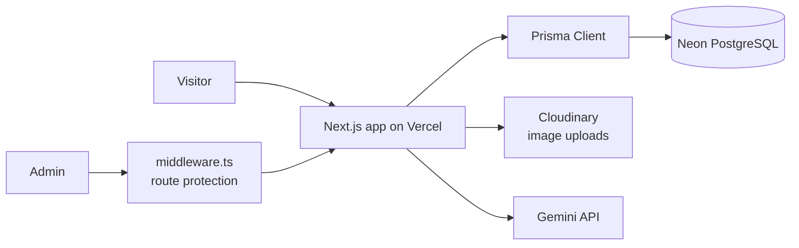

# Advanced Portfolio

Personal portfolio and admin platform built with Next.js. Public pages show projects and credentials; a protected admin area manages content and shows traffic analytics.

**Live site:** https://advanced-portfolio-orpin.vercel.app/

## Stack (from `package.json`)

| Area | Technology |
|---|---|
| Framework | Next.js 16 (App Router), React 19, TypeScript |
| Styling / UI | Tailwind CSS 4, shadcn/ui, Base UI, Framer Motion, lucide-react |
| Auth | Auth.js (`next-auth` v5 beta) with `@auth/prisma-adapter`; passwords hashed with `bcryptjs` |
| Database | PostgreSQL (Neon) via Prisma 7 and `@prisma/adapter-pg` |
| Media | Cloudinary (`cloudinary`, `next-cloudinary`) |
| Forms / state | React Hook Form + Zod, Zustand |
| AI | `@google/generative-ai` |
| Other | `pdf-parse` |

## Architecture



Key paths: `src/` (app code), `prisma/` (schema and migrations), `middleware.ts` (auth gate), `next.config.ts`.

## Features

- Project and credential management through an admin dashboard
- Traffic analytics stored in PostgreSQL
- Authenticated admin area protected by middleware
- Image uploads through Cloudinary

Add or remove items here so the list matches what is deployed.

## Local setup

Prerequisites: Node.js 20+, a PostgreSQL database (a free Neon project works), a Cloudinary account.

```bash
git clone https://github.com/Mohitsai3579/Advanced-Portfolio.git
cd Advanced-Portfolio
npm install            # runs `prisma generate` automatically
cp .env.example .env   # then fill in your own values
npx prisma migrate dev # creates tables in your database
npm run dev            # http://localhost:3000
```

### Environment variables

Copy `.env.example` and fill in real values locally. Never commit `.env`, and never paste real keys into the README, issues or screenshots.

List the exact variable names your code reads:

```bash
grep -rhoE "process\.env\.[A-Z0-9_]+" src prisma.config.ts middleware.ts | sort -u
```

Typical entries for this stack: database URL, Auth.js secret and URL, Cloudinary cloud name / API key / API secret, Gemini API key. Make `.env.example` match the grep output.

## Scripts

| Command | What it does |
|---|---|
| `npm run dev` | Start the dev server |
| `npm run build` | Production build |
| `npm run start` | Serve the production build |
| `npm run lint` | ESLint |

There is no automated test suite yet; CI runs lint, type check and build (see `.github/workflows/ci.yml`).

## Deployment (Vercel)

1. Import the repo into Vercel.
2. Add every variable from `.env.example` in Project Settings, Environment Variables.
3. Run `npx prisma migrate deploy` against the production database (locally with the production `DATABASE_URL`, or as a build step).
4. Deploy. `postinstall` regenerates the Prisma client during the build.

## Security notes

- Secrets live only in environment variables; `.env*` stays in `.gitignore`.
- Admin routes are gated by `middleware.ts` and server-side session checks.
- Rotate any key that has ever been committed, even if you deleted it later (it stays in git history).

## Roadmap

- [ ] Unit tests (Vitest) for validation schemas and utilities
- [ ] Playwright smoke test for the public pages and admin login
- [ ] Screenshots / GIF in this README
